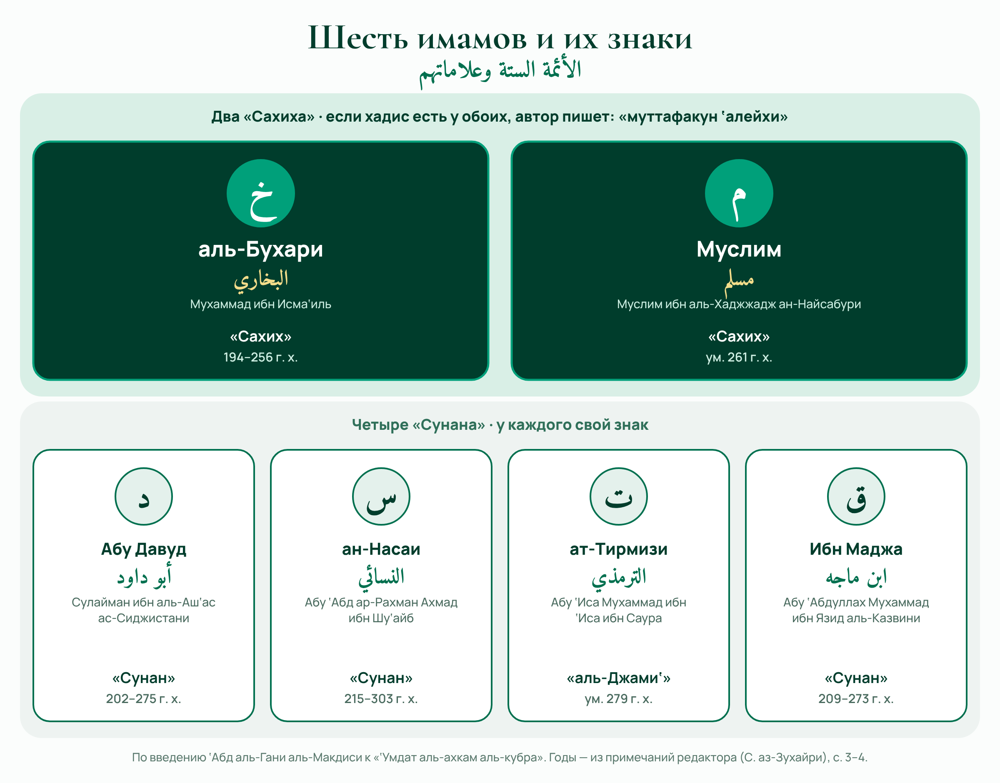

# Урок 1. Введение автора

**Книга:** «‘Умдат аль-ахкам аль-кубра» · **Источник:** Абд аль-Гани аль-Макдиси, «Умдат аль-ахкам аль-кубра», ред. Самир аз-Зухайри (Эр-Рияд: Мактабат аль-Ма‘ариф, 2009), с. 3–4 · **Рубрика:** Разборы хадисов · **Проходной балл:** 60%

**Кратко:** Вступление Абд аль-Гани аль-Макдиси к «‘Умдат аль-ахкам аль-кубра»: что это за книга, зачем убраны иснады и что значат знаки сборников.

## О книге и авторе
Автор книги — хафиз Таки ад-Дин Абу Мухаммад ‘Абд аль-Гани ибн ‘Абд аль-Вахид аль-Макдиси, ханбалитский учёный, знаток хадиса. Он умер в 600 году хиджры. Это тот же автор, чью «Краткую сиру Пророка ﷺ» мы читаем в цикле «Сира».

У него две книги с похожим названием. «‘Умдат аль-ахкам» (малая) — короткая, известная книга для заучивания. «‘Умдат аль-ахкам аль-кубра» («большая») — расширенная: кроме «Сахихов» аль-Бухари и Муслима, в ней есть хадисы из сборников Абу Давуда, ан-Насаи, ат-Тирмизи и Ибн Маджи, поэтому автору и понадобились знаки для этих сборников.

> بسم الله الرحمن الرحيم
>
> ربِّ يسّر
>
> قال الشَّيخُ، الإمامُ، العَالمُ، الزَّاهدُ، الحافِظُ، الفقيهُ، تقيُّ الدين أبو محمدٍ عبدُ الغني بنُ عبد الواحد بنِ عليّ بن سُرور المقدسي رضي الله عنه: الحمد للَّه على السَّراء والضرَّاء، وأشهدُ أن لا إله إلا الله، وحدَه لا شرِيكَ له، شهادةً مُدّخرةً ليوم اللقاء، وأشهدُ أن محمدًا عبدُه ورسولُه أكرمُ الأصفياء، وخاتَمُ الأنبياء، صلى الله عليه، وعلى آله، وصحبه؛ أهل الصِّدقِ والوَفاءِ، صلاةً دائمةً إلى يوم الجزاء.

*Перевод:* Во имя Аллаха, Милостивого, Милосердного.

Господи, облегчи!

Сказал шейх, имам, учёный, аскет, хафиз, факих Таки ад-Дин Абу Мухаммад ‘Абд аль-Гани ибн ‘Абд аль-Вахид ибн ‘Али ибн Сурур аль-Макдиси, да будет доволен им Аллах: Хвала Аллаху и в радости, и в беде. Свидетельствую, что нет божества, кроме Аллаха, Единого, у Которого нет сотоварища, — свидетельством, сбережённым ко Дню встречи с Ним. И свидетельствую, что Мухаммад — Его раб и посланник, благороднейший из избранных и печать пророков. Да благословит Аллах его, его семью и сподвижников — людей правдивости и верности — благословением непрестанным до Дня воздаяния.

_«Умдат аль-ахкам аль-кубра», с. 3–4_

> وبعدُ: فهذه أحاديثُ في الأحكام؛ منِ الحلالِ والحرامِ، اختصرتُها، وحذفتُ أسانيدَها؛ ليقرب تناولها علَى من أراد حفظها، وأضفتُها إلى كُتب الأئمة المتفق على كُتُبِهم، المجمع على إتقانهم وضبطهم؛ ليركنَ القلبُ إليها، ويحصلَ الاعتمادُ عليها.

*Перевод:* А затем. Это хадисы о законоположениях — о дозволенном и запретном. Я сократил их и убрал их иснады, чтобы их легче было взять тому, кто захочет выучить их наизусть. И я указал, в книгах каких имамов они приводятся: тех, чьи книги приняты всеми и в чьей точности и тщательности все единодушны, — чтобы сердце на эти хадисы полагалось и на них можно было опереться.

_«Умдат аль-ахкам аль-кубра», с. 3–4_

> فما كان فيه مُتَّفَقٌ عَلَيْهِ فهو مما اجتمعَ عليه الإمامان: محمد بنُ إسماعيل البخاري، ومسلم بنُ الحجّاج النِّيسابوري.
>
> وعَلَامةُ البُخارِي على انفرادِه: خ.
>
> وعَلَامَةُ مسلم على انفراده: م.
>
> وعَلَامَةُ أبي داود؛ سليمان بنِ الأشعث السجستاني: د.
>
> وعَلَامَةُ أبي عبد الرحمن أحمد بن شُعَيب بن عليّ النَّسائي: س.
>
> وعَلَامَةُ أبي عيسى؛ محمد بن عيسى بن سَوْرة التِّرْمذيّ: ت.
>
> وعَلَامَةُ أبي عبد الله؛ محمد بنِ يزيد بن ماجه القَزْويني: ق.
>
> ورُبما أضفنا الشيء إلى غير هؤلاء فَنُسمّيه.

*Перевод:* Если о хадисе сказано «муттафакун ‘алейхи» («согласованный»), значит, его привели оба имама: Мухаммад ибн Исма‘иль аль-Бухари и Муслим ибн аль-Хаджжадж ан-Найсабури.

Знак аль-Бухари, когда он приводит хадис один: «خ».

Знак Муслима, когда он приводит хадис один: «م».

Знак Абу Давуда Сулаймана ибн аль-Аш‘аса ас-Сиджистани: «د».

Знак Абу ‘Абд ар-Рахмана Ахмада ибн Шу‘айба ибн ‘Али ан-Насаи: «س».

Знак Абу ‘Исы Мухаммада ибн ‘Исы ибн Сауры ат-Тирмизи: «ت».

Знак Абу ‘Абдуллаха Мухаммада ибн Язида ибн Маджи аль-Казвини: «ق».

А иногда мы указываем и на другие сборники, кроме этих, и тогда называем их.

_«Умдат аль-ахкам аль-кубра», с. 3–4_

> وأسأل الله أن ينفعنا بذلك، ومَن قرأه، أو حفظه، أو نظر فيه، وأن يجعله خالصًا لوجهِه، موجبًا لرضاه، إنه سميعُ الدُّعاء، وهو حسبُنا ونِعم الوكيل.

*Перевод:* Прошу Аллаха, чтобы Он принёс этим пользу нам и каждому, кто это прочтёт, выучит наизусть или просмотрит, и чтобы сделал этот труд искренним ради Его Лика и заслуживающим Его довольства. Поистине, Он слышит мольбу. Достаточно нам Аллаха, и как прекрасен Он как Покровитель!

_«Умдат аль-ахкам аль-кубра», с. 3–4_

## Словарь
- **الأحكام** — Ахкам — законоположения: что дозволено, что запрещено, что обязательно. Хадисы ахкам — хадисы, на которых строится фикх.
- **الحلال والحرام** — Халяль и харам — дозволенное и запретное.
- **الإسناد (ج. الأسانيد)** — Иснад — цепочка передатчиков: «мне рассказал такой-то со слов такого-то…» до Пророка ﷺ. Автор убрал иснады, оставив сам текст хадиса и сахабу, который его передал.
- **مُتَّفَقٌ عَلَيْهِ** — Муттафакун ‘алейхи — «согласованный»: хадис, который привели и аль-Бухари, и Муслим.
- **الحافظ** — Хафиз — знаток хадисов, помнящий их огромное число с иснадами.
- **الزاهد** — Захид — аскет, отказавшийся от лишнего в мирской жизни ради вечной.
- **الإتقان والضبط** — Иткан и дабт — точность и тщательность передатчика: он передаёт хадис так, как услышал, без ошибок.
- **السَّرَّاء والضَّرَّاء** — Сарра’ и дарра’ — радость и беда, лёгкое и тяжёлое.
- **الأصفياء** — Асфийа’ — избранные: те, кого Аллах избрал из Своих рабов.
- **يوم اللقاء** — День встречи — Судный день, когда раб встретит своего Господа.

## Пересказ
Автор начинает книгу так, как обычно начинали книги учёные: с басмалы и короткой мольбы «Господи, облегчи!». Потом он восхваляет Аллаха и в радости, и в беде, произносит оба свидетельства и просит благословения для Пророка ﷺ, его семьи и сподвижников.

Затем автор объясняет, что это за книга. В ней хадисы о законоположениях — о дозволенном и запретном. Чтобы их было легко учить наизусть, он убрал иснады и оставил только текст хадиса. Но чтобы читатель мог доверять каждому хадису, после него он указывает, в каких известных сборниках этот хадис приводится.

После этого автор объясняет свои знаки. Слова «муттафакун ‘алейхи» значат, что хадис есть и у аль-Бухари, и у Муслима. Если хадис есть только у одного из них или в других сборниках, автор ставит букву: «خ» — аль-Бухари, «م» — Муслим, «د» — Абу Давуд, «س» — ан-Насаи, «ت» — ат-Тирмизи, «ق» — Ибн Маджа. Если хадис взят из другого сборника, автор называет его прямо.

Завершает автор мольбой: чтобы Аллах принёс пользу этой книгой ему и каждому, кто её прочтёт, выучит или хотя бы просмотрит, и чтобы труд был искренне ради Аллаха.

## Шесть имамов-составителей сборников
Шесть имамов, которых называет автор (годы — из примечаний редактора, Самира аз-Зухайри, к с. 3–4):

аль-Бухари — родился в 194 г. х., умер в 256 г. х.;
Муслим ибн аль-Хаджжадж — умер в Нишапуре в 261 г. х.;
Абу Давуд ас-Сиджистани — родился в 202 г. х., умер в 275 г. х.;
ан-Насаи — родился в Насе в 215 г. х., умер в 303 г. х.;
ат-Тирмизи — умер в Тирмизе в 279 г. х.;
Ибн Маджа аль-Казвини — родился в 209 г. х., умер в 273 г. х.

_Шесть имамов, их сборники и знаки, которыми автор обозначает эти сборники. Нажмите, чтобы открыть крупно. («Умдат аль-ахкам аль-кубра», с. 3–4)_

## Пользы из введения
1. Автор начал книгу с басмалы, восхваления Аллаха, двух свидетельств и благословения Пророка ﷺ — так принято начинать книги у учёных.

2. Восхвалять Аллаха нужно не только в радости, но и в беде: «Хвала Аллаху и в радости, и в беде».

3. Благословение просят для Пророка ﷺ, а вместе с ним — для его семьи и сподвижников.

4. Эта книга — хадисы о законоположениях: в них доводы для фикха. Поэтому в следующих уроках к каждому хадису мы приводим, что из него следует по основному мнению ханбалитского мазхаба.

5. Иснады можно убрать, чтобы облегчить заучивание, если указан сборник, где хадис приводится с иснадом: по этому указанию хадис можно найти и проверить.

6. Доверие к хадису строится на сборниках имамов, в чьей точности единодушны учёные.

7. «Муттафакун ‘алейхи» — хадис, который привели и аль-Бухари, и Муслим.

8. Знаки сборников: خ — аль-Бухари, م — Муслим, د — Абу Давуд, س — ан-Насаи, ت — ат-Тирмизи, ق — Ибн Маджа.

9. Ученику стоит начинать учёбу с искреннего намерения ради Аллаха и с мольбы о пользе знания — как сделал автор.

## Тест (8 вопросов)

**1. Как называется книга, по которой идут уроки цикла?**

- ✅ «‘Умдат аль-ахкам аль-кубра»
- «Сахих» аль-Бухари
- «Булюг аль-марам»

_Пояснение:_ Это расширенная («большая») «‘Умдат аль-ахкам» Абд аль-Гани аль-Макдиси.

**2. О каких хадисах эта книга?**

- ✅ О законоположениях: дозволенном и запретном
- О достоинствах сур Корана
- О событиях Судного дня

_Пояснение:_ «Это хадисы о законоположениях — о дозволенном и запретном».

**3. Зачем автор убрал иснады?**

- ✅ Чтобы хадисы легче было выучить наизусть
- Потому что иснады слабые
- Чтобы скрыть передатчиков

_Пояснение:_ «…чтобы их легче было взять тому, кто захочет выучить их наизусть».

**4. Что такое иснад?**

- ✅ Цепочка передатчиков хадиса
- Перевод хадиса
- Толкование хадиса

_Пояснение:_ Иснад — цепочка: «мне рассказал такой-то со слов такого-то…».

**5. Что значат слова «муттафакун ‘алейхи»?**

- ✅ Хадис привели и аль-Бухари, и Муслим
- Хадис привели все шесть имамов
- Хадис слабый

_Пояснение:_ Автор: «…его привели оба имама: аль-Бухари и Муслим».

**6. Какой буквой автор обозначает Муслима?**

- ✅ م
- خ
- س

_Пояснение:_ «Знак Муслима, когда он один: م».

**7. Какой буквой автор обозначает Ибн Маджу?**

- ✅ ق
- م
- ت

_Пояснение:_ Ибн Маджа аль-Казвини — «ق».

**8. Что делает автор, если хадис взят из другого сборника, не из шести?**

- ✅ Называет этот сборник
- Ставит букву «خ»
- Не указывает источник

_Пояснение:_ «А иногда мы указываем и на другие сборники… и тогда называем их».

## Источники и сверка

- Арабский текст введения сверен слово в слово с изданием: ред. Самир ибн Амин аз-Зухайри, Эр-Рияд: Мактабат аль-Ма‘ариф, 1-е изд., 1430/2009, т. 1, с. 3–4 (оцифровка turath.io, книга 11194). Расхождений, кроме огласовок и номеров примечаний, нет.
- Годы жизни шести имамов — из примечаний редактора к с. 3–4.
- Хадисов и цитат из книг мазхаба в уроке нет.

## Не проверено

- Сверка шла через сервис, который сравнивал текст за нас (прямой доступ к сайтам с этого компьютера закрыт). Хорошо бы один раз глазами сверить с бумажной книгой или PDF.
- Год смерти автора (600 г. х.) и то, что малая «‘Умда» содержит только хадисы аль-Бухари и Муслима, — общеизвестные сведения, в этом издании не сверялись.
